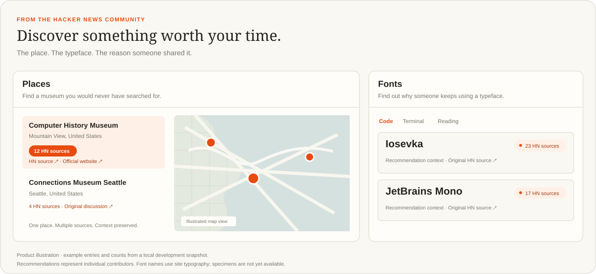
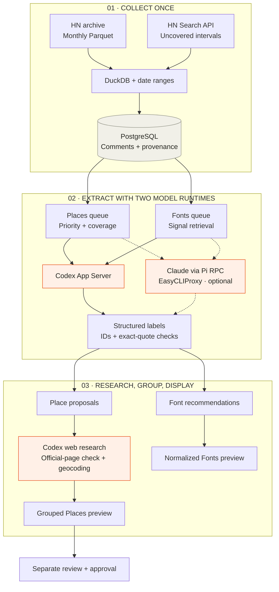

<div align="center">

<h1></h1>

### Places worth visiting. Typefaces worth trying.

Recommendations from people on Hacker News,<br />with the context and original conversations that make them useful.

**[Try it locally](#run-it)** · [See the collections](#find-the-recommendation-you-would-have-missed) · [How we built it](#the-pipeline)

<sub>Built by <a href="https://x.com/thegrandimam">grandimam</a>. Discoveries by the Hacker News community. Research previews; details can need correction.</sub>

</div>

<p align="center">
  
</p>

## Find the recommendation you would have missed

A tiny museum in a comment thread. An unusual library. A typeface someone has used for years. hacker.living makes those recommendations browsable, with a link back to the person who shared them.

| **Find a place** | **Find a typeface** |
| :--- | :--- |
| Explore museums, observatories, libraries, and engineering landmarks on a map. | Browse fonts for code, terminals, reading, interfaces, and design. |
| See why someone recommended it, with researched locations and official links where available. | Understand why someone prefers it, with recommendation context and the original HN source. |
| One card per matched place. Source counts bring repeated recommendations together. | One card per normalized family. A source count keeps the evidence visible without a wall of comments. |

**Keep the context.** Source counts measure distinct HN comments, not votes or an endorsement by the whole community. Current entries are research previews. Font specimens and licenses still await verification; places without a location remain in the list.

---

## How we built a recommendation engine from HN comments

The interface is the result. Underneath it is a resumable data pipeline: collect the conversations once, extract recommendations with **Codex** and an optional **Claude** runtime, research place identities, and publish a catalog with its evidence attached.

[](./scripts/codex-labeler.ts)
[](./scripts/pi-labeler.ts)
[](./server/pipeline/collect.ts)
[](./server/db/migrations/)
[](./shared/)

[The pipeline](#the-pipeline) · [Codex + Claude](#two-model-runtimes-one-queue) · [Scaling](#what-happened-when-we-turned-up-the-workers) · [Operations](./docs/operations.md)

## The build, in numbers

| **2.06 million** | **38.9 thousand** | **239** | **$419** |
| :---: | :---: | :---: | :---: |
| Comments collected | Unique comments analyzed | Monthly archive files downloaded | Reported project spend |

<sub>Local development snapshot: 2,058,164 collected comments and 38,925 processed comments. The downloaded archive is about 12.4 GB. Downloaded does not mean analyzed; processed does not mean recommended. The $419 is maker-reported project spend, not a token-cost calculation. Processing is currently paused.</sub>

## The pipeline



**A saved result can advance immediately.** Location research does not wait for every comment in a month to finish labeling. Collection, extraction, and research have independent worker pools and pause controls.

The dotted Claude path is implemented and optional. Its RPC preflight reached EasyCLIProxy but was blocked by an expired upstream Claude login during this build. It has not demonstrated sustained classification throughput; the completed extraction figures above are not a claim of dual-provider production throughput.

### 01 — Collect the conversations once

Historical comments come from [open-index/hacker-news](https://huggingface.co/datasets/open-index/hacker-news). We pin the archive revision, verify file checksums, and read monthly Parquet files with DuckDB. For intervals outside available archive coverage, collection falls back to the [HN Search API](https://hn.algolia.com/api).

The date-range collector saves available live comments before classification. It is not a handful of targeted searches dressed up as an archive scan. Source coverage still depends on the archive and search index.

Each saved comment retains its HN ID, author, date, text, source link, and discussion context. Collection progress is checkpointed with the saved rows, so a restart can continue from committed work.

**One collection, multiple products.** Fonts scans a snapshot of comments already saved for a Places run—including comments that Places classified as software or unrelated. There is no second archive download just to build the font catalog.

### 02 — Let models interpret; let code enforce the contract

A model reads up to **15 comments per batch** and returns structured labels. Code checks the response before it enters the catalog:

- Every input must have exactly one result. Unexpected, duplicate, and missing IDs fail validation.
- Positive recommendations stay separate from mentions, criticism, and unclear results.
- Low-confidence place or font identities do not become positive catalog entries.
- Quoted text must match a contiguous source excerpt, with at most 25 quoted words per comment.
- Reasons are paraphrases. Fonts, features, links, and preferences must not be invented.

Request-local IDs such as `c1` and `c2` avoid making the model copy long database identifiers. Validated results are mapped back to the original IDs, then committed **one comment at a time** with model and usage metadata.

**Places and Fonts use different retrieval strategies:** Places changes queue priority without dropping the rest of the saved comments—three batches favor recommendation signals, and every fourth continues coverage. Fonts first selects broad font/typeface/name signals, then classifies those comments. The Fonts filter is useful retrieval, not a claim of exhaustive semantic recall.

### 03 — Turn “worth visiting” into a researched place

An extracted name is a proposal. To put it on a map, the research stage:

```text
Re-fetch the original HN comment
    ↓
Codex researches the institution and official website
    ↓
Fetch the official page and check an identifying excerpt
    ↓
Query Nominatim for actual location candidates
    ↓
Select a matching institution; validate country and geometry
    ↓
Save the location, sources, dated checks, and unresolved issues
```

The model does not supply coordinates from memory. It selects from geocoder results; code rejects unsuitable matches such as streets, cities, or the wrong country. An uncertain result stays unresolved. Source changes, HTTP failures, and ambiguous identities remain inspectable.

We made this stage **location-first**: new image retrieval is deferred so it does not hold up coordinates and official-link research. Existing credited photographs are preserved. A missing location does not erase the recommendation—it remains in the list without a map pin.

### 04 — Group the evidence into a useful interface

Repeated place recommendations are grouped before pagination using normalized researched names, city/country, and nearby coordinates. Distant branches remain separate. Font names merge conservatively by normalized case and whitespace; aliases and variants can still need review.

Each card shows a compact **HN source count**. It counts distinct comments, not repeated model attempts, votes, unique people, or community consensus. Places **Top** sorts by that count; **A–Z** sorts by name.

React, TypeScript, Tailwind, and Leaflet present the results. The web app reads PostgreSQL through an API, so new saved research can appear without rebuilding the frontend.

## Two model runtimes. One queue.

| | **Codex** | **Claude** |
| :--- | :--- | :--- |
| Connection | Existing authenticated App Server over a local Unix WebSocket | Pi RPC processes through the existing EasyCLIProxy provider |
| Role | Comment classification and separate place web research | Additional Places/Fonts classification capacity |
| Session | Isolated, ephemeral threads | Fresh in-memory session per classification request |
| Tools | Classification uses no tools; research permits web search | Classification runs without tools or project context |
| Model | Runtime-selected model ID is recorded with each result | `claude-sonnet-4-6` by default; configurable |
| Admission | Adaptive model-call limit and provider cooldown | Authentication preflight before claiming real jobs |

There are no model API keys in the repository. The adapters use existing local authenticated runtimes. Claude goes through **EasyCLIProxy**, not OpenRouter. Provider account limits and authentication still apply.

Both paths use the same label validators and durable job table. They compete for atomic leases instead of independently reading and labeling the same backlog. Pi has its own worker identities, so restarting a Codex worker does not reclaim Pi’s active jobs.

Browse the implementation: [Codex adapter](./scripts/codex-labeler.ts) · [Pi adapter](./scripts/pi-labeler.ts) · [Claude pool](./server/pipeline/pi-pool.ts) · [Batch claims](./server/pipeline/claim-labels.ts)

## What happened when we turned up the workers

We moved from small worker pools to **100 Places label workers**, **100 Fonts label workers**, and an optional **100-slot Claude pool shared across both products**. These are queue capacities, not measured simultaneous model calls.

Simply increasing worker counts exposed two bottlenecks: database claim contention and shared model-server overload. We addressed them separately.

| Bottleneck | What we changed |
| :--- | :--- |
| Many workers competing for the same rows | Reserve a batch atomically with `FOR UPDATE SKIP LOCKED` |
| Repeated database round trips | Fetch all batch inputs in one query; keep model calls outside DB transactions |
| One slow stage holding up downstream results | Independent stage pools; admit research as soon as a proposal is saved |
| Bursts overwhelming Codex | Start at 8 model calls per process, grow gradually after successes, halve admission on overload |
| Explicit provider limits | Defer jobs with a shared five-minute provider cooldown and refund the failed admission attempt |
| A broken Claude login claiming useful work | Require one successful RPC preflight before opening the pool |

The database pool is bounded separately from worker capacity. More workers do not require one held database connection per model call. The implemented admission gate increases its limit by one after every 32 successful calls, up to its configured maximum.

**We do not claim a measured comments-per-second rate or a full-archive completion time.** Throughput depends on the provider, comment length, web research, external services, and retries.

## A flow you can stop without losing your place

```text
COLLECT  ──[gate]──▶  LABEL  ──[gate]──▶  RESEARCH  ──▶  PREVIEW
   │                    │                   │
checkpoint          atomic saves        saved evidence
   │                    │                   │
resume later        independent queue    retry unresolved work
```

Closing one gate holds its pending inputs while other open stages drain saved work. An in-flight atomic unit finishes before pausing. An incomplete collection remains incomplete; draining its downstream queue does not mean the entire date range was collected.

Underneath, the system uses:

- **Leases and fencing tokens** so stale workers cannot commit after losing ownership.
- **Run locks and versioned inputs** to avoid overlapping executions and reuse saved results.
- **Bounded retries and explicit failures** instead of silently dropping difficult records.
- **Cached research and HTTP responses** to avoid repeating recent external requests unnecessarily.
- **Separate product state** so font extraction does not overwrite Places decisions.

This is resumable, explicitly started processing. No recurring ingestion schedule is configured, and starting the website does not start the workers. Pipeline controls remain in the backend; the product UI shows simple database-backed metrics.

## Evidence is a separate layer from approval

| Layer | What it means |
| :--- | :--- |
| **Saved comment** | Source material, not a recommendation |
| **Model label** | An interpretation that passed structural validation |
| **Research preview** | A browsable draft with available evidence and unresolved details |
| **Approved place** | A separately reviewed record that passed publication gates |

`/api/discoveries` serves Places previews. `/api/fonts` serves draft font recommendations. `/api/places` serves the separately approved catalog. Putting something on the preview map does not promote it into the approved catalog.

Authors, dates, exact source URLs, research sources, and link-check dates stay with the evidence. Font licenses, files, official links, and specimen rendering still await verification. A successful official-link check does not guarantee current opening hours or accessibility.

## Run it

```sh
git clone https://github.com/grandimam/hacker.living.git
cd hacker.living
bash scripts/setup-env.sh
docker compose up --build -d --wait
```

Open **[localhost:4317](http://localhost:4317)**. Compose starts PostgreSQL/PostGIS, applies migrations, and serves the production app. A fresh checkout starts with an empty database; local datasets, credentials, and archives are excluded from Git and the image. Existing database volumes are reused.

On an x86-64 Ubuntu or Amazon Linux 2023 AWS instance, prepare the machine first:

```sh
sudo bash scripts/setup-aws.sh --domain hacker.living
# Reconnect SSH, then:
docker compose up --build -d --wait
```

The installer configures Docker and the optional Caddy HTTPS service. Point DNS at the instance and allow inbound TCP 80/443. It does not transfer your local catalog or start model workers.

**Moving your existing catalog to AWS?** Run `npm run catalog:export`, copy the compressed file, and import it inside the app container. [Processed-data transfer instructions →](./docs/operations.md#move-the-processed-catalog-to-aws)

**[Read the operations guide →](./docs/operations.md)** for development, supported OS versions, credentials, backups, port changes, API routes, and deployment details.

### Start the pipeline explicitly

These commands run on the host with Node.js, the database, and the authenticated model runtime available:

```sh
# Collect and process Places over an inclusive UTC date range
npm run pipeline:run -- --from 2026-08-01 --to 2026-08-21

# Reuse saved comments to extract Fonts
npm run pipeline:fonts -- run --source-run <places-run-id> --workers 8

# Add the optional Claude pool alongside Codex
npm run pipeline:pi -- --places-run <places-run-id> --font-run <font-run-id> --workers 100
```

### Find the interesting parts

| Read this | To understand |
| :--- | :--- |
| [`collect.ts`](./server/pipeline/collect.ts) | Archive reading, Search API fallback, checkpoints |
| [`label.ts`](./server/pipeline/label.ts) | Batched extraction and per-comment commits |
| [`claim-labels.ts`](./server/pipeline/claim-labels.ts) | Atomic queue claims across competing workers |
| [`worker-pool.ts`](./server/pipeline/worker-pool.ts) | Independent stage admission and draining |
| [`model-admission.ts`](./scripts/model-admission.ts) | Adaptive model concurrency and overload response |
| [`enrich.ts`](./server/pipeline/enrich.ts) | Place research, official-page checks, and coordinate selection |
| [`fonts/`](./server/fonts/) | Reusing comments for a separate product |
| [`discovery.ts`](./server/db/discovery.ts) | Place grouping, source counts, and pagination |
| [`migrations/`](./server/db/migrations/) | The durable data model |

```sh
npm run check          # TypeScript + optional export validation
npm test               # Unit and behavior tests
npm run test:database   # PostGIS integration tests
npm run build          # Build without shipping a dataset
```

## Built on the community

The recommendations come from individual Hacker News contributors. [open-index](https://huggingface.co/datasets/open-index/hacker-news) supplies the historical archive; [HN Search by Algolia](https://hn.algolia.com/) supplies indexed search. [OpenStreetMap contributors](https://www.openstreetmap.org/copyright) supply map and geocoding data. Available photographs retain their individual attribution and license details.

[HackerTV](https://github.com/dsalzman/hackertv) inspired the archive-plus-incremental approach. Our implementation extends the idea into separate extraction and research stages, a shared worker queue, and multiple discovery collections.

---

<div align="center">

**Built by [grandimam](https://x.com/thegrandimam).**<br />Follow the build, [read the code](https://github.com/grandimam/hacker.living), or [suggest a correction](https://github.com/grandimam/hacker.living/issues).

Independent of Hacker News and Y Combinator. Source counts are evidence counts, not endorsements.

</div>

## License

The project code is [MIT licensed](./LICENSE). HN source content, the source archive, OpenStreetMap data, and bundled photographs have separate rights and terms. See [Third-party notices](./THIRD_PARTY_NOTICES.md). See [Security](./SECURITY.md) for reporting and the deployment boundary.
