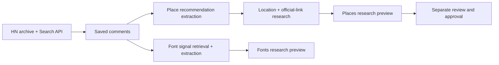

<div align="center">

# hacker.living

### Good finds, shared by curious people.

Discover places and typefaces recommended by people on Hacker News.<br />Keep the context. Follow the original conversation.

[](https://react.dev/)
[](https://www.typescriptlang.org/)
[](https://tailwindcss.com/)
[](https://postgis.net/)
[](./compose.yaml)

[Start locally](#start-locally) · [The collections](#the-collections) · [Data & provenance](#where-the-data-comes-from) · [Development](#development)

Built by **[grandimam](https://x.com/thegrandimam)** · [Code](https://github.com/grandimam/hacker.living) · [Feedback](https://github.com/grandimam/hacker.living/issues)

</div>

---

HN comments contain useful recommendations that are easy to lose inside a discussion. hacker.living organizes them into browsable collections, with source links and the reason someone recommended something.

The discoveries belong to the community members who shared them. This project collects and researches their recommendations; a source count measures distinct comments, not votes or endorsement by HN.

## The collections

| | Explore | What you get |
| :--- | :--- | :--- |
| **Places** | Small museums, observatories, unusual libraries, engineering landmarks | A map and list, category filters, official links where identified, and one card per matched place with an HN source count |
| **Fonts** | Typefaces recommended for coding, terminals, reading, and design | A filterable catalog with recommendation context, a source count, and a link to the original HN comment |

**Current status:** browsable research previews. Place matches can need correction. Font names use the site’s typography; font files, licenses, official links, and specimens await verification. Missing locations stay visible without map pins. Existing credited photographs are retained; new image research is deferred.

## Start locally

With Docker Desktop or Docker Engine + Compose running:

```sh
git clone https://github.com/grandimam/hacker.living.git
cd hacker.living
docker compose up --build -d --wait
```

**Open [localhost:4317](http://localhost:4317).**

Compose builds the frontend, starts PostgreSQL/PostGIS, waits for the database, applies pending migrations, and serves the app. Starting the site does **not** start model workers or resume processing.

> **Bring your own data.** A fresh installation has an empty catalog. Datasets, research results, credentials, and database backups are excluded from Git and the Docker image. An existing local `hacker-living_postgres_data` volume is reused.

| Task | Command |
| :--- | :--- |
| View startup logs | `docker compose logs -f app` |
| Check service health | `docker compose ps` |
| Stop without deleting data | `docker compose stop` |
| Start again | `docker compose up -d --wait` |
| Rebuild after a code update | `docker compose up --build -d --wait` |

**Port already in use?** Run `APP_PORT=4318 docker compose up --build -d --wait` and open [localhost:4318](http://localhost:4318). Set `APP_PORT` in your ignored `.env` to keep that choice.

<details>
<summary><strong>Credentials and persistence</strong></summary>

Compose uses `POSTGRES_PASSWORD` from `.env` when supplied. Without it, the local development password is `hacker-living-local`. For a new setup, `npm run db:setup` generates random credentials; an existing `.env` is retained. Keep credentials consistent when reusing a database volume.

By default, the app and database ports bind to localhost. The optional public profile publishes only Caddy on ports 80/443. The app runs as an unprivileged user. Database files live in the named Docker volume, independently of the containers. Stopping, rebuilding, or recreating containers preserves that volume; removing it deletes the database.

</details>

## Where the data comes from

Public comments come from the [open-index Hacker News archive](https://huggingface.co/datasets/open-index/hacker-news), with the [HN Search API](https://hn.algolia.com/api) used for intervals outside available archive coverage.



### Source → recommendation → research

1. **Collect and save.** Comments and provenance are stored in PostgreSQL. Archive files remain local Parquet files, read with DuckDB. Collection checkpoints make interrupted work resumable.
2. **Extract recommendations.** AI distinguishes positive recommendations from mentions, criticism, and unrelated material. Places prioritizes likely recommendations while continuing broad coverage. Fonts retrieves comments containing font-related signals before classification; that retrieval is not exhaustive.
3. **Research place identities.** The system looks for an official site and coordinates, records dated link checks, and retains unresolved results. It does not invent coordinates or replace missing photos with generated imagery.
4. **Group and display.** Matching researched place names in the same city and nearby location share one card. Distant branches remain separate. Font names merge conservatively by case and whitespace. Source badges count distinct HN comments.
5. **Review separately.** Displaying a research preview does not approve it for the verified catalog. Publication requires explicit review and evidence checks.

Original authors, dates, source links, and extracted evidence stay in the database. Summaries are paraphrases; quotations are validated against source text. A working official URL does not establish opening hours or accessibility.

### What the metrics mean

| Metric | Meaning |
| :--- | :--- |
| **Collected** | Distinct saved comments associated with collection runs |
| **Processed** | Distinct saved comments analyzed for Places or Fonts; a comment can yield no recommendation |
| **Processing now** | Active, unexpired processing job leases |
| **Cost so far** | Maker-reported project spend: **$419**, not an automatic billing integration |

Counts update from PostgreSQL. Archive coverage, HN indexing, extraction accuracy, and entity matching all have limits; this is not a complete index of every HN recommendation.

## Development

Use **Node.js 22.12+** and Docker for frontend/backend development:

```sh
npm ci
npm run db:setup
npm run db:up
npm run db:migrate
npm run dev
```

Open [localhost:4317](http://localhost:4317). If the Compose app is using that port, run `docker compose stop app` first. Vite serves React and the local API; PostgreSQL remains the source of truth.

```sh
npm run check          # Strict TypeScript and optional export validation
npm test               # Unit and behavior tests
npm run test:database   # PostGIS integration tests; requires the local DB
npm run build          # Production frontend; no dataset required
```

### Project layout

```text
src/                 React pages and Tailwind components
shared/              Types, filtering, and validation contracts
server/
  db/                Catalog queries, jobs, and SQL migrations
  fonts/             Font retrieval, extraction, and catalog
  pipeline/          Collection, labeling, research, and controls
scripts/             Local commands, build, and container startup
tests/               Behavior tests and small test-only fixtures
compose.yaml         App + persistent PostgreSQL/PostGIS
Dockerfile           Production app image
```

### Storage and API

| Data | Storage |
| :--- | :--- |
| Comments, labels, proposals, and font recommendations | PostgreSQL |
| Coordinates and geographic queries | PostGIS |
| Runs, leases, retries, checkpoints, and research checks | PostgreSQL |
| Raw archive, logs, exports, and backups | Ignored local `data/` |
| Small reproducible test examples | `tests/fixtures/`; never product seeds |

| Endpoint | Purpose |
| :--- | :--- |
| `GET /api/health` | Database connectivity |
| `GET /api/discoveries` | Grouped place research previews |
| `GET /api/fonts` | Draft font families and recommendation evidence |
| `GET /api/metrics` | Collection, processing, and reported cost |
| `GET /api/places` | Separately approved places only |

## Run processing explicitly

Processing runs on the host using the existing authenticated **Codex app server**. Browsing the site needs no model login. The Docker app does not contain model credentials or start background workers automatically.

```sh
# Collect a date range and process Places
npm run pipeline:run -- --from 2026-08-01 --to 2026-08-21

# Continue an existing run, respecting its saved stage controls
npm run pipeline:run -- --run <places-run-id>

# Extract Fonts from comments already saved by a Places run
npm run pipeline:fonts -- run --source-run <places-run-id> --workers 8
npm run pipeline:fonts -- status --run <font-run-id>
npm run pipeline:fonts -- pause --run <font-run-id>
```

Calendar dates include both days in **UTC**; explicit timestamp ranges use an exclusive end. Large ranges can involve many model requests. Saved stage controls allow collection, labeling, and research to pause independently; in-flight atomic units finish before a pause takes effect. Pipeline screens are hidden from product navigation.

Jobs use database leases, fencing tokens, bounded retries, and atomic saves. Worker limits are capacity ceilings; actual model concurrency adapts to provider limits. Failures remain available for inspection and retry. No recurring collection schedule is configured.

<details>
<summary><strong>Optional: Claude through Pi RPC + EasyCLIProxy</strong></summary>

An additional labeling pool can share the durable queue with Codex:

```sh
npm run pipeline:pi -- --places-run <places-run-id> --font-run <font-run-id> --workers 100
```

This selects the existing `cliproxyapi` provider through EasyCLIProxy, with `claude-sonnet-4-6` by default. It does not use OpenRouter. Configure `PI_BIN` and optionally `PI_CLAUDE_MODEL` in `.env`.

The pool must pass an authentication preflight before claiming real work. An unavailable provider remains blocked and retries preflight every minute. Model credentials stay outside the project. Pi labels comments; place location and link research remains a separate stage.

</details>

<details>
<summary><strong>Review, publication, and backup</strong></summary>

```sh
npm run pipeline:review
npm run pipeline:draft -- --proposal <proposal-id> --out data/drafts/place.json
npm run pipeline:approve -- --file data/drafts/place.json --reviewer "Your name"
npm run pipeline:verify
npm run db:backup
```

Inspect source evidence and verify the place and recommendation before setting review flags. `/api/places` serves only approved records that satisfy the publication gates. A later failed evidence or official-link check can hide a published record.

`npm run db:export` creates an optional local JSON export. Builds and the running app do not require that file. Archive downloads and backups also stay outside Git.

</details>

## A single-server launch

On an x86-64 AWS instance running Ubuntu 22.04/24.04/26.04/26.10 or Amazon Linux 2023, copy or clone this checkout, then run:

```sh
sudo bash scripts/setup-aws.sh --domain hacker.living
```

The script installs Docker Engine, Compose, Buildx, Git, and utilities; enables Docker at boot; creates a random database password if `.env` is missing; and enables the optional Caddy HTTPS service. Existing credentials and database volumes are retained. It adds the invoking login user to the Docker group, which grants host administration through Docker. Node.js and npm are not needed on the server.

Reconnect SSH once for group membership, then start the site yourself:

```sh
cd hacker.living
docker compose up --build -d --wait
```

Point `hacker.living` at the instance and allow inbound TCP **80 and 443** in its AWS security group. Caddy obtains and renews HTTPS certificates once DNS resolves. App and database ports stay bound to localhost. The script does not alter DNS, AWS security groups, or start workers. HTTPS is not ready until certificate issuance succeeds; inspect `docker compose logs -f caddy`.

For a different hostname, pass `--domain your-domain.com` on first setup, or edit `SITE_ADDRESS` in `.env` afterward. The script preserves existing settings on repeat runs. Installation follows the [Docker Ubuntu repository instructions](https://docs.docker.com/engine/install/ubuntu/), [AWS Amazon Linux instructions](https://docs.aws.amazon.com/serverless-application-model/latest/developerguide/install-docker.html), and [Docker plugin installation guidance](https://docs.docker.com/compose/install/linux/). An existing database volume without `.env` requires restoring the matching credentials, rather than generating a replacement password.

The initial deployment can run the app and PostgreSQL together with Compose. Use an **x86-64 Linux** server to match the pinned PostGIS image. The AWS setup enables the included Caddy proxy and generates credentials for a fresh database. Outside that setup, the default Compose configuration serves only localhost.

Keep database backups off the instance and test restoring them. Provisioning AWS, configuring DNS/TLS, and transferring your local database are separate deployment steps; cloning this repository does not copy your catalog.

## Credit where it belongs

- **Recommendations:** individual Hacker News contributors. Original source links remain attached to the evidence.
- **Archive:** [open-index/hacker-news](https://huggingface.co/datasets/open-index/hacker-news).
- **Search:** [HN Search by Algolia](https://hn.algolia.com/).
- **Maps and geocoding:** [OpenStreetMap contributors](https://www.openstreetmap.org/copyright). Review tile-service requirements before sustained public traffic.
- **Photos:** author, source, license, and modification details are retained where images are available; see `/credits`.
- **Inspiration:** [HackerTV](https://github.com/dsalzman/hackertv) and its archive-plus-incremental approach.

---

<div align="center">

Built by **[grandimam](https://x.com/thegrandimam)**.<br />Have a correction or a recommendation? [Open an issue](https://github.com/grandimam/hacker.living/issues).

Independent of Hacker News and Y Combinator. Recommendations express their authors’ opinions.

</div>
